# THONEY — AI-Powered Smart Robot Assistant

**Designed and built by Honey-Leen Rivera** (New York Institute of Technology)

THONEY is a voice-controlled AI robot companion — *Study. Work. Play. Protect.* — built in two phases under two degree programs:

1. **Phase 1 (2025):** THONEY itself — the AI robot assistant — as an **undergraduate Senior Design Project**.
2. **Phase 2 (2026):** **OAS (Object Authentication Service)** — a security layer that uses the THONEY robot as its platform — as a **graduate MS Cybersecurity project**.

---

## Phase 1 — THONEY, the AI Robot Assistant (Senior Design, 2025)

**BS Electrical and Computer Engineering Technology — Senior Design Project**
January – May 2025 · Advisor: Dr. K. Ahmed

### Overview

THONEY is an interactive, intelligent robotic assistant built around OpenAI's GPT-4o. It combines a real-time voice assistant, an expressive animated face, a fully interactive touchscreen interface, and a mobile robot base — designed to be educational, entertaining, and practical for students, creators, professionals, and families.

### Demo

- 🎥 **Senior Design demo (2025 prototype):** https://youtu.be/cnq9Y-hA1Jw

### Key features (as delivered, May 2025)

- **AI voice assistant** — wake word *"Hey Thoney"*; real-time conversation using GPT-4o, speech recognition, and text-to-speech
- **Emotional expression engine** — animated facial expressions (idle, talking, sleep, emotion-based) synced with voice
- **Touchscreen interface** — vivid 7-inch display with animated expressions, icons, weather, and clock
- **Multimedia & app control** — Spotify / YouTube Music, browser, RetroPie games, Zoom, notes, camera
- **Real-time information** — weather, news, calendar, and stock data via online APIs
- **Camera & vision** — photo/video capture, QR code scanning, optional surveillance features
- **Personal assistant tools** — voice-controlled shopping list, Google Calendar sync, scheduling, reminders
- **Entertainment hub** — chess, tarot, music, videos, and games
- **Mobility** — Sphero RVR+ base with a dual-power setup (RVR+ battery or wall power, with back-feed protection)

### Hardware & cost

Raspberry Pi 4 · 7-inch GeeekPi touchscreen · 48MP camera · Sphero RVR+ · speaker, microphone, USB hubs, power bank, custom 3D-printed (STL) casing · **approx. $1,200 total build cost**

*Build note: the original printed casing was later removed as components were added and upgraded; the current build runs in its open form, which also makes the wiring and components easier to access and change.*

### Results

The final evaluation (May 7, 2025) demonstrated live voice interaction with GPT-4o responses, Sphero movement, and the animated touchscreen interface. The project met its design expectations and shows potential for educational robotics, smart companions, and interactive entertainment platforms.

---

## Phase 2 — OAS: Securing the Robot (Graduate Project, 2026)

**MS Cybersecurity — Project I: Object-Based Authentication for a Robotic System**
Spring 2026 · Advisor: Prof. P. Gasti

### Overview

For the graduate phase, the THONEY robot became the platform for a security project: the **Object Authentication Service (OAS)**. Instead of relying only on a password, PIN, or voice command, OAS applies the authentication principle **"something you have"**: the user presents a predefined physical object to the robot's camera, and protected actions unlock only if the object is visually verified.

### Demo

- 🎥 **OAS module — updated:** https://youtu.be/ORiX5Qba2XU

### How it works

1. **Enroll** — the user places the chosen object in a guided on-screen target region; the system auto-captures multiple samples (stable auto-enrollment, no manual frame capture)
2. **Authenticate** — verification combines ORB feature matching, color-histogram comparison, and score-based decision logic: strict enough to reject incorrect or previously used objects, tolerant of small motion, lighting variation, and angle changes
3. **Reject** — incorrect or unrelated objects are refused, with clear visual feedback (guided target region, bounding-box cues, background dimming, status messages)
4. **Change object** — a controlled replacement flow: verify the currently authorized object → delete the old template → capture the replacement → validation-only check of the new object
5. **Fallbacks & logging** — PIN-based fallback; per-session logs of enrollment, attempts, rejections, and acceptances; an honest accelerator status check (if the Hailo runtime is present but the OAS model pipeline is not initialized, the system logs that and uses a safe OpenCV fallback rather than pretending inference is active)

### System architecture (layers)

| Layer | Role |
|---|---|
| Boot | Entry point, mode selection, process launching |
| UI | Fullscreen dashboard, overlays, expression display, status handling |
| Assistant | Wake behavior, command interpretation, TTS, conversational responses |
| Security | OAS enrollment, verification, protected-command gating |
| Vision | Camera capture, object contour extraction, matching logic |
| Robot Control | Movement and robot-specific execution in mobile mode |

### Results

The final OAS is a working, demonstrable security workflow — not just a proof of concept: it enrolls an object, authenticates the correct object, rejects impostor objects, replaces the authorized object in a controlled way, and maintains clear session logs. The full report also documents its limitations honestly (environmental sensitivity, false positives, recognition instability) and the tuning decisions behind the final balance between usability and strictness.

---

## Gallery

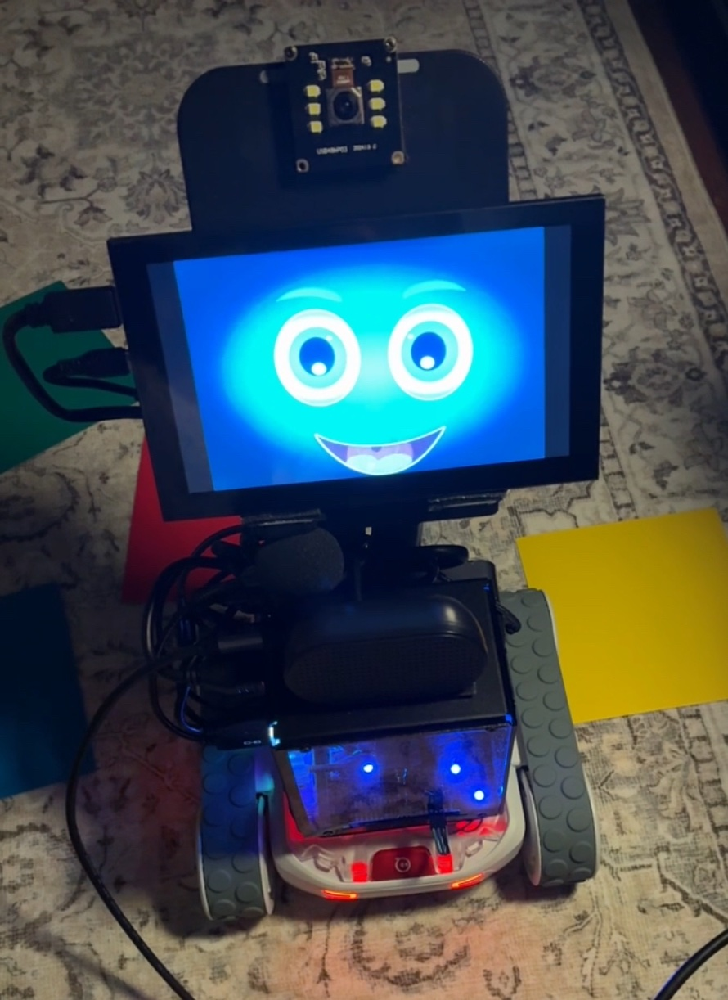

*THONEY today — the current open build, face screen on.*

### THONEY (Phase 1)

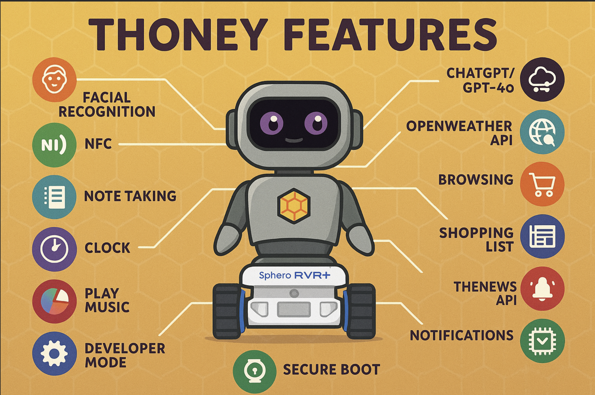

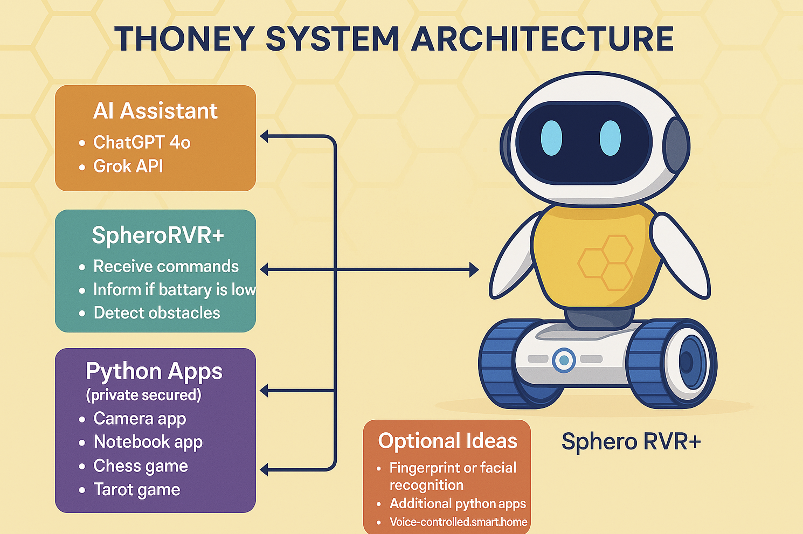

<table>
<tr>
<td>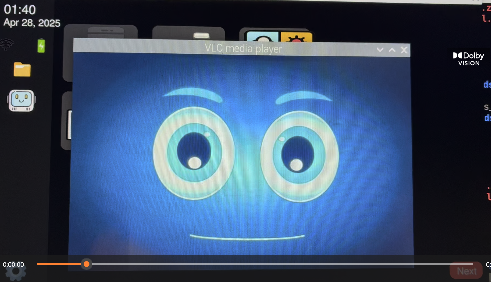</td>
<td>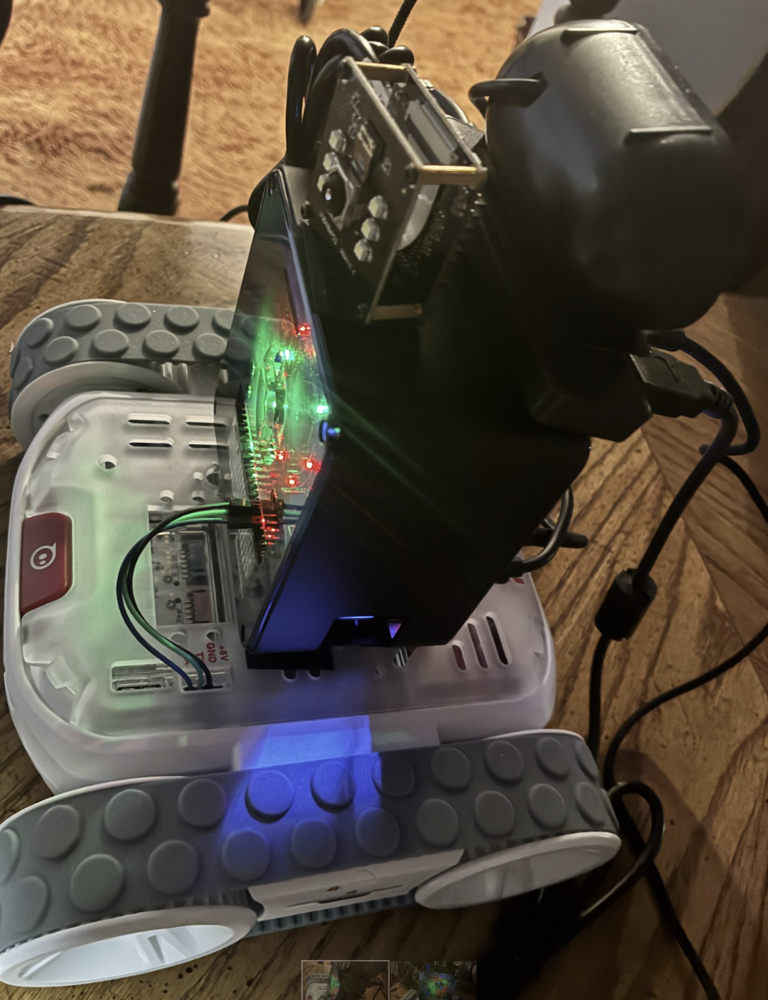</td>
</tr>
</table>

### OAS (Phase 2)

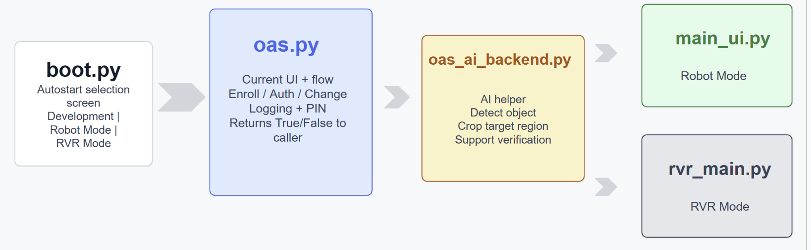

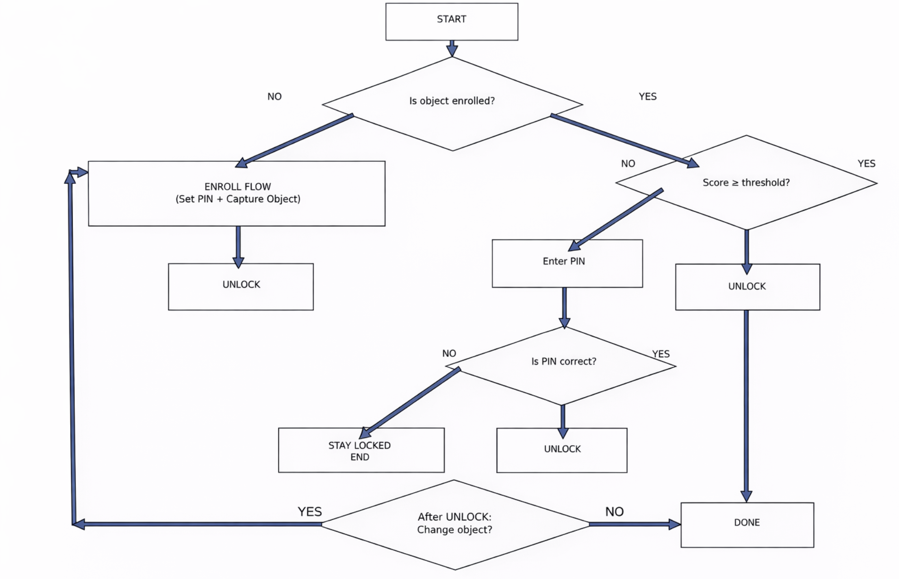

<table>
<tr>
<td>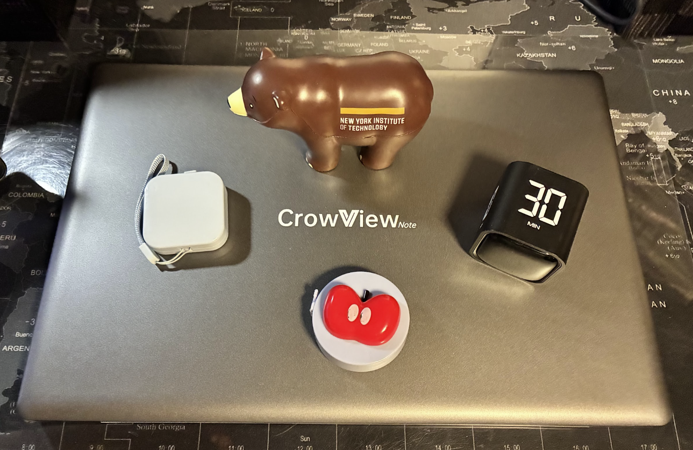</td>
<td>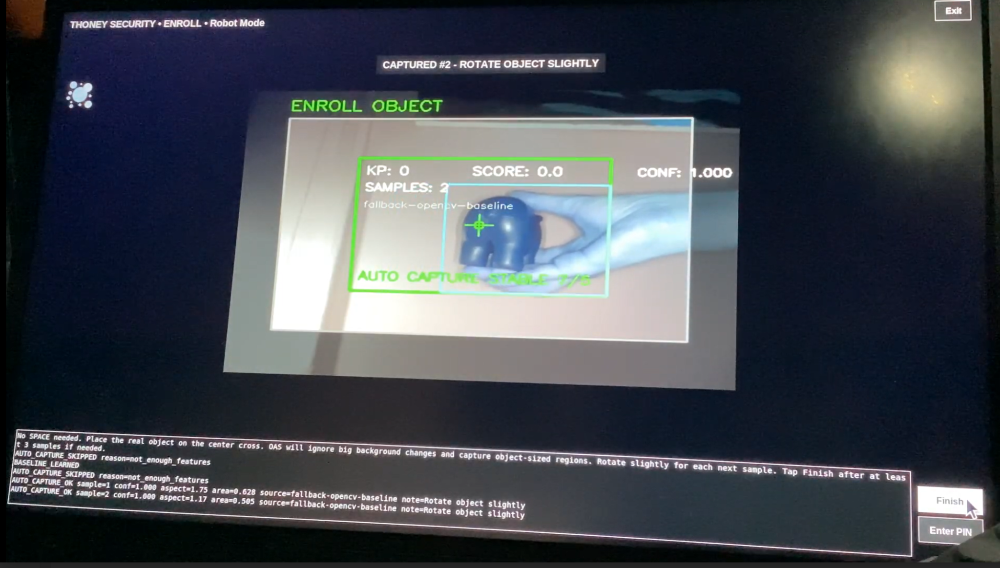</td>
</tr>
<tr>
<td>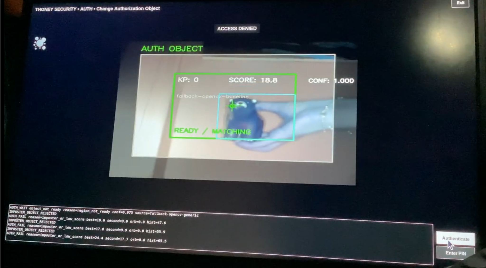</td>
<td>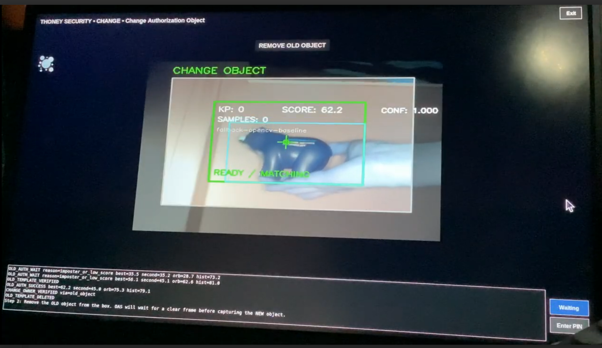</td>
</tr>
</table>

*More photos in the `screenshots/` folder: casing views and the original design sketch.*

---

## Project timeline

| Date | Milestone |
|---|---|
| January 2025 | THONEY senior design project begins |
| May 2025 | Senior design demo (2025 prototype) — https://youtu.be/cnq9Y-hA1Jw |
| Spring 2026 | OAS module demo (graduate continuation) — https://youtu.be/ORiX5Qba2XU |

**Updated version — THONEY + OAS combined: more developed version — video to follow.**

---

## Private archive

The complete project documentation and source code are maintained in a private archive, including:

- Full Senior Design Project Report (THONEY) — 27 pages
- Full MS Project I Final Report (OAS) — 19 pages
- OAS source code — `oas.py`, `oas2.py` (Python)
- Complete photo set of the build

This public repository presents the projects' designs, features, architecture, and outcomes; the full reports and source code are not published.

---

## Author

**Honey-Leen Rivera** — Cybersecurity-focused Technical Specialist; MS Cybersecurity candidate, NYIT (expected December 2026); BS Electrical and Computer Engineering Technology, NYIT (2025).
GitHub: https://github.com/honeyleenjr · LinkedIn: https://www.linkedin.com/in/honeyleenjr
